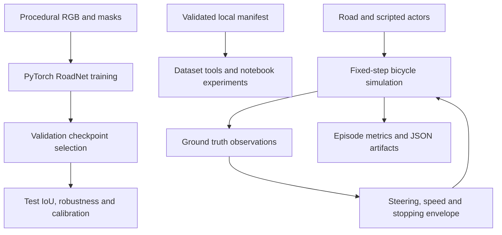

# Architecture

## Implemented flows

Perception and simulation are separate experimental flows. The driver has no dependency
on image predictions. The local planner and A* are independently exercised research
components, not an implicit online planner in the default driver.

## Ownership of behavior

- `simulation` defines coordinates, vehicle state, actor motion, geometry and sensors.
- `control` computes steering and acceleration from state and reference road.
- `planning` creates sampled paths/trajectories and reports feasibility explicitly.
- `perception` owns image contracts, segmentation-derived boxes and tracking.
- `evaluation` computes metrics without making selection decisions.
- `experiments` orchestrates repeated runs and writes reproducible artifacts.
- Notebooks explain experiments and visualize package outputs. Core algorithms live in `src`.

## Perception baseline

RoadScenes produces independently seeded splits from one stylized distribution. Colors
strongly correlate with class labels. RoadNet has three padded convolutions with
increasing dilation and a classification head. It uses no pretrained backbone. The
implementation does not claim invention of convolutions or segmentation.

The original trainer uses AdamW, cross entropy and validation mean IoU. Checkpoints
contain version, configuration and weights. They do not contain optimizer state;
resume training is not implemented. Runs refuse overwrite. The newer training primitives
provide loss ablations, gradient clipping and validation-only sweeps without changing
the original trainer's public contract.

A previously measured locked CPU run with seed 42, 128 training scenes and 15 epochs
achieved test mean IoU 0.7944 over 64 scenes, with class IoUs 0.9890/0.9442/0.4499.
This was one seed on an easy synthetic distribution. The short notebook training run
uses smaller settings and does not reproduce that score. A 3-epoch run predicted only
background, illustrating why execution success and useful learning are separate results.

## Simulation baseline

The vehicle is a forward-only kinematic bicycle with rear-axle pose, bounded speed,
acceleration and steering rate. Scripted actors use constant linear velocity or follow
road arc length. The default driver combines pure pursuit (or Stanley), a speed PID,
and a conservative stopping envelope. Substeps reduce discrete collision misses;
continuous swept collision guarantees are not provided.

The range sensor raycasts actor rectangles with seeded noise/dropout. The occupancy
model updates observed hit beams only; unknown is preserved separately. The camera
model projects/unprojects points, and the Kalman filter estimates constant-velocity
motion from position observations. Neither is a photorealistic sensor simulator.

## Next milestones

1. Select a real recorded dataset, document its license and map its labels to a manifest.
2. Evaluate learned detection and depth models with independent annotated data.
3. Connect selected perception outputs to simulation through explicit uncertainty and
   timing contracts; compare against the ground-truth observation baseline.
4. Integrate a richer simulator and traffic behavior, including occlusion and signals.
5. Establish release gates for accuracy, robustness, latency and regression coverage.

Hardware deployment and real vehicle interfaces require their own design and validation.
